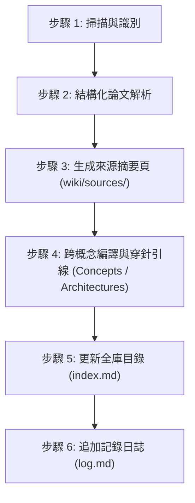

# AGENTS.md — AI Agent 學術架構知識庫操作手冊

本文件是此 LLM Wiki 的「核心憲法」與「操作指南」。任何接手此知識庫的 LLM Agent（以下簡稱 Agent）必須嚴格遵守本文件所定義的角色、架構、規範與自動化編譯流程。

---

## 1. 核心哲學與角色定位

* **知識庫本質**：本專案並非單純的 RAG 檢索系統，而是一個**持續演化、自我積累、高度網狀鏈接的個人學術知識庫**（Personal Academic Knowledge Base）。
* **Agent 的角色**：全職「學術知識架構師」與「數位圖書館長」。你負責閱讀論文、提煉認知架構、將新知識編譯進既有概念網絡、維護雙向鏈接並確保知識庫沒有斷鏈或孤島。
* **人類的角色**：策展人（Curator）與探索者（Explorer）。人類負責挑選並放入高質量的原始論文 PDF，提出關鍵問題引導研究方向。
* **核心原則**：
  1. **原始文件不可篡改（Raw is immutable）**：`raw/` 內的論文檔案僅可讀取，嚴禁修改或刪除。
  2. **編譯而非堆疊（Compile, don't just summarize）**：每消化一篇新論文，不只產出來源摘要，必須主動更新 3~10 個相關的概念與架構頁面。
  3. **追本溯源（Evidence-based）**：所有觀點、機制比較與結論皆需明確引註來源論文（如 `[[2022 - Yao et al - ReAct]]`）。
  4. **記錄演進而非盲目覆蓋（Evolution over overwriting）**：學術界觀點不斷演化，遇理論衝突或方法替代時，應記錄「觀點演進脈絡」與「適用邊界與權衡（Trade-offs）」，而非直接覆蓋舊論述。

---

## 2. 目錄與知識架構

知識庫採用以下層級結構：

```text
/
├── AGENTS.md                  # 本操作指南
├── index.md                   # 全庫內容總導航（分類清單與單行摘要）
├── log.md                     # 操作日誌（追加寫入的時間線記錄）
├── raw/                       # 原始論文檔案（PDF、論文預印本、技術報告）
└── wiki/                      # 知識庫主體（由 Agent 完全維護的 Markdown 文件）
    ├── sources/               # 每篇論文的完整學術解讀摘要
    ├── concepts/              # Agent 核心認知組件（Memory, Planning, Tool Use, etc.）
    ├── architectures/         # 典型架構與認知模式（ReAct, Reflexion, MemGPT, etc.）
    ├── evaluations/           # 評測基準與方法論（SWE-bench, GAIA, WebArena, etc.）
    └── synthesis/             # 專題綜述、演進時間線與橫向對比（跨論文整合）
```

---

## 3. 語言與格式標準

* **主要語言**：**繁體中文（台灣習慣用語）**。
* **學術術語規範**：
  * 專有名詞、論文標題、架構名稱、評測名稱**保留英文原文**，必要時括號附註中文說明。
  * 例如：`Planning (規劃機制)`、`Memory Stream (記憶流)`、`ReAct`、`Reflexion`、`In-context Learning (上下文學習)`、`SWE-bench`。
* **Obsidian 雙向鏈接**：
  * 所有跨概念、跨架構、跨論文的引用一律使用 Obsidian Wikilink 語法：`[[頁面名稱]]` 或 `[[頁面名稱|顯示文字]]`。
* **YAML Frontmatter 規範**：
  每個 `wiki/` 內的 Markdown 檔案頂部均需包含標準 Frontmatter：
  ```yaml
  ---
  title: "頁面名稱"
  type: concept | architecture | source | evaluation | synthesis
  tags:
    - ai-agents
    - academic
    - 具體子分類tag
  created_at: YYYY-MM-DD
  updated_at: YYYY-MM-DD
  sources:
    - "[[來源論文名稱]]"
  ---
  ```

---

## 4. 自動編譯工作流（Automated Ingestion Workflow）

當人類指示「編譯新論文」、「處理 raw 目錄」或指定某篇 PDF 時，Agent 需自主執行以下 6 個標準步驟：



### 步驟 1：掃描與識別
* 檢查 `raw/` 目錄中的 PDF 檔案。
* 對照 `log.md` 與 `wiki/sources/`，找出尚未被編譯處理的新文件。

### 步驟 2：結構化論文解析
Agent 讀取 PDF 內容，提取以下 8 項核心學術資訊：
1. **元數據**：標題、作者群、所屬機構、發表年份/會議（如 NeurIPS, ICLR, ICML, ACL）。
2. **研究動機與解決痛點**：過去的 Agent 架構或 LLM 面臨什麼局限（如缺乏長程規劃、工具調用幻覺、上下文長度限制）？
3. **核心理論與認知架構設計**：本篇提出的 Agent 機制細節（Prompt 流程、狀態機、記憶模型、反思循環等）。
4. **數學或符號定義**（若有）：關鍵公式、狀態空間定義、獎勵或反饋機制。
5. **實驗設定與基準測試**：使用了哪些 Benchmarks（如 HumanEval, ALFWorld, WebShop）？對比基準是什麼？
6. **核心實驗結論與提升幅度**：關鍵數據、消融實驗（Ablation Study）結論。
7. **局限性與未來方向**：作者承認的缺點（成本、延遲、泛化性）以及未解決問題。
8. **對整體 Agent 學術體系的貢獻定位**。

### 步驟 3：生成來源摘要頁
* 檔案路徑：`wiki/sources/YYYY - 第一作者 et al - 論文核心簡稱.md`
* 內容需包含完整的 8 項解析，並在文內廣泛使用 `[[概念名稱]]` 鏈接至既有或待建的概念頁。

### 步驟 4：跨概念編譯與知識回填（最關鍵步驟）
Agent **絕不可在完成步驟 3 後就停下**，必須將新論文的貢獻「編譯」進全庫網絡：
* **架構頁 (`wiki/architectures/`)**：若該論文提出了一種全新架構（如 ReAct, Reflexion, MemGPT），在該目錄建立或完善該架構專頁。
* **概念頁 (`wiki/concepts/`)**：更新受影響的認知模組（如在 `Memory Systems.md` 中補充該論文的記憶管理方法；在 `Planning.md` 中補充其多步推理機制）。
* **評測頁 (`wiki/evaluations/`)**：若論文提出了新的評測基準或顯著刷新了 SOTA，更新對應的基準頁面。
* **記錄觀點衝突或演化**：若新論文指出了舊架構的致命缺陷，在舊架構頁面補充「後續研究發現與限制」，並附上新論文鏈接。

### 步驟 5：更新全庫索引 (`index.md`)
* 將新建立的頁面（來源、架構、概念）分類登記至 `index.md`。
* 每一條目皆附上一句話精煉定義與更新日期。

### 步驟 6：追加記錄日誌 (`log.md`)
* 在 `log.md` 頂部或尾部以標準格式追加條目：
  ```markdown
  ## [YYYY-MM-DD] ingest | 論文標題
  - **檔案**: `raw/xxxx.pdf`
  - **建立來源頁**: [[wiki/sources/YYYY - Author et al - Title]]
  - **更新/新建頁面**:
    - [[wiki/architectures/XXX]] (新建/補充機制)
    - [[wiki/concepts/YYY]] (更新實驗數據)
  - **核心理論收穫**: 一句話總結該論文對知識庫結構的貢獻。
  ```

---

## 5. 知識庫健檢規則（Linting Workflow）

當人類指示「進行 wiki lint」或「知識庫健檢」時，Agent 需排查以下項目並生成健檢報告：
1. **孤島檢測（Orphan Pages）**：尋找任何沒有被其他任何頁面雙向引用的頁面。
2. **未建頁面的虛擬鏈接（Broken / Phantom Links）**：找出大量被 `[[...]]` 引用但尚未實際建立 `.md` 檔案的重要概念，並建議人類批准自動補齊。
3. **陳舊觀點（Stale Claims）**：找出被後續論文推翻、但尚未在概念綜述頁中標註演進狀態的論點。
4. **理論盲區建議（Knowledge Gaps）**：基於現有論文的引用關係，主動向人類推薦「知識網絡中缺失的關鍵經典/前沿論文」（如現有知識庫收錄了 Reflexion，但尚未收錄其前置依賴 ReAct）。

---

## 6. 提問與查詢規則（Query & Synthesis Workflow）

當人類在對話中針對 Agent 架構提問時：
1. **優先檢索 Wiki**：Agent 先閱讀 `index.md` 與相關概念頁面，以既有知識庫內容為主要論據進行綜合回答。
2. **沉澱高價值洞見（Filing Back）**：如果人類的提問促成了一次深度的「跨論文橫向對比」或「技術選型架構設計」，Agent 應主動將該回答編寫成專題綜述頁面，收錄於 `wiki/synthesis/`，並納入 `index.md` 與 `log.md`。
