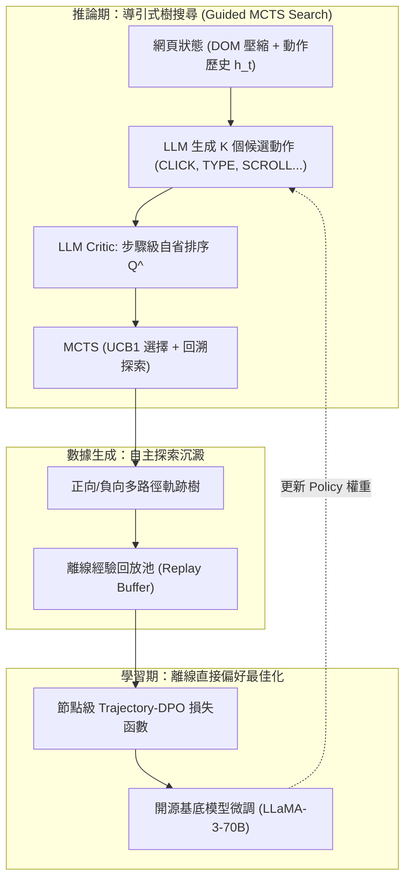

# Agent Q: Advanced Reasoning and Learning for Autonomous AI Agents

**Agent Q** 是由 MultiOn 與史丹佛大學團隊於 2024 年提出的一種結合**推論期樹搜尋（MCTS）**、**AI 自省過程監督（Process-level Critique）**與**離線軌跡偏好最佳化（Trajectory-DPO）**的突破性自主演化 Agent 架構（[[2024 - Putta et al - Agent Q]]）。它成功攻克了網頁自主代理在長步數長程任務中「獎勵稀疏」與「責任分配（Credit Assignment）」的世紀難題。

---

## 1. 核心認知閉環架構

---

## 2. 關鍵技術突破

### 2.1 克服長程任務責任分配（Credit Assignment）
在真實網頁預訂任務中（平均 13.9 步），傳統 RL 僅在最終給予 0 或 1 獎勵。中途任何細節錯誤（如填錯人數或日期）都會導致失敗，使得模型無法得知究竟是「哪一步做錯了」。
* **Agent Q 解方**：在 MCTS 節點擴展時，引入 **LLM Critic 進行即時動作排序**，形成中間步驟的「過程獎勵（Process Supervision）」，與 MCTS 經驗回報融合為複合價值評估：
  $$Q(h_t, a_t^i) = \alpha \tilde{Q}(h_t, a_t^i) + (1-\alpha) \hat{Q}(h_t, a_t^i)$$

### 2.2 離線學習失敗經驗（Negative Trajectories Matter）
傳統強化微調（RFT）通常只篩選成功樣本進行監督學習（SFT），忽略了失敗路徑中極具價值的反面教材。
* **Agent Q 解方**：採用 **Trajectory-DPO**，直接從 MCTS 探索產生的成功與失敗分叉中構建偏好對，免去訓練昂貴的價值網路（Value Network），大幅提升開源模型的零樣本泛化能力。

### 2.3 推論期算力擴展（Test-Time Compute Scaling）
呼應 Richard Sutton 的「苦澀的教訓（The Bitter Lesson）」，Agent Q 證明在推論階段賦予 Agent 搜尋與回溯能力（MCTS），其效益遠超盲目擴大模型參數：
* 在真實 OpenTable 預訂任務中，僅微調後的 Agent Q 具備 81.7% 成功率；**一旦在推論時開啟 MCTS 搜尋，成功率一舉躍升至 95.4%**。

---

## 3. 實證效能對比 (Performance Highlights)

| 任務環境 | 基底模型 | 原始 Zero-Shot | 傳統 DPO/RFT | Agent Q (Zero-Shot) | Agent Q + MCTS (搜尋) |
| :--- | :--- | :--- | :--- | :--- | :--- |
| **WebShop** (模擬電商) | xLAM-v0.1-r (Mixtral) | 28.6% | 31.3% ~ 40.6% | 41.5% | **50.5%** *(超越人類 50.0%)* |
| **OpenTable** (真實預訂) | LLaMA-3-70B-Instruct | 18.6% (GPT-4o: 62.6%) | 67.2% ~ 71.8% | **81.7%** *(超車 GPT-4o)* | **95.4%** *(極限性能)* |

---
## 引用來源
* [[2024 - Putta et al - Agent Q]]
* [[2026 - Sapkota et al - AI Agents vs Agentic AI]]
* [[Agent Planning & Reasoning]]
* [[Tool Augmentation & Function Calling]]
