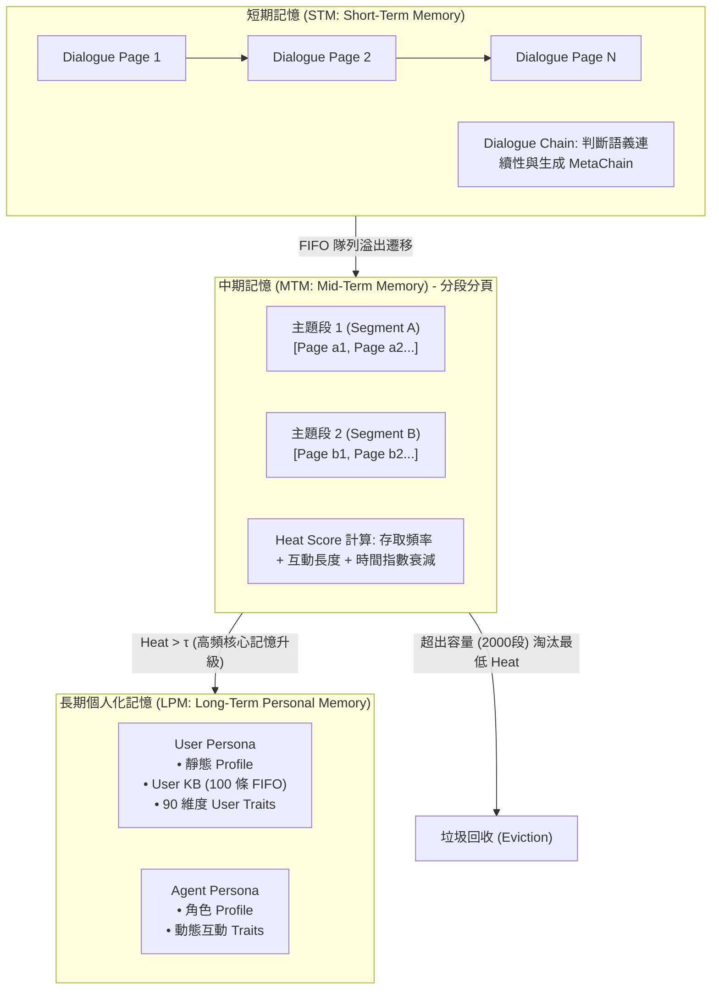

# MemoryOS (智慧代理記憶作業系統架構)

**MemoryOS** 是由北京郵電大學與騰訊 AI Lab 於 EMNLP 2025 提出的全面性 Agent 記憶管理作業系統架構（[[2025 - Kang et al - Memory OS of AI Agent]]）。該架構解決了傳統 LLM Agent 依賴扁平隊列（如 MemGPT 的純 FIFO）易導致「主題混雜（Topic Mixing）」與「高 Token 成本」的痛點，開創性地將電腦作業系統中成熟的**分段分頁（Segmented Paging）**與**熱度置換（Heat-based Eviction）**原理引入代理心智模型中。

---

## 1. 系統整體架構 (System Architecture)

MemoryOS 整合了儲存（Storage）、更新（Updating）、檢索（Retrieval）、生成（Generation）四大核心模組，建構三層記憶空間：

---

## 2. 核心運作機制與數學定義

### 2.1 MTM 語義分段（Segmented Paging）
不同於傳統單純把所有對話丟進向量庫，MemoryOS 將對話頁以「主題」為邏輯段進行聚類。新頁面進入 MTM 時，計算與各主題段的混合相似度：
$$F_{score} = \cos(e_s, e_p) + \frac{|K_s \cap K_p|}{|K_s \cup K_p|}$$
當 $F_{score} > 0.6$ 時自動歸併入既有主題段，實現同一話題上下文的精確歸檔。

### 2.2 熱度置換算法 (Heat-based Eviction)
每個主題段的記憶保留優先權由熱度評分決定：
$$Heat = \alpha \cdot N_{visit} + \beta \cdot L_{interaction} + \gamma \cdot \exp\left(-\frac{\Delta t}{\mu}\right)$$
* 兼顧**訪問頻率（$N_{visit}$）**、**話題討論深度（$L_{interaction}$）**與**時間新鮮度（$\exp(-\Delta t/\mu)$）**。
* 超過閾值 $\tau=5$ 的高價值記憶被蒸餾至 LPM，避免冗餘記憶佔用中間運算資源。

### 2.3 兩階段語義檢索 (Two-Stage Retrieval)
當使用者發起查詢時：
1. **段級檢索**：先比對各主題段的摘要向量，篩選出 Top-$m$（預設 5）個最相關主題段。
2. **頁級檢索**：在選定的主題段內部，細粒度抽取 Top-$k$（預設 10）個對話頁。
此機制避免了傳統向量庫全域檢索導致的「斷章取義」與雜訊干擾。

---

## 3. 與傳統 Agent 記憶架構橫向對比

| 記憶架構 | 記憶儲存結構 | 淘汰/管理機制 | 長對話穩定性 | Token 消耗與調用開銷 |
| :--- | :--- | :--- | :--- | :--- |
| **MemGPT** | 雙層（主上下文 + 外部儲存） | 扁平 FIFO 翻頁 | 容易產生主題混雜 | 極高（平均 16,977 Tokens） |
| **A-Mem** | 互聯筆記圖譜 (Note Graph) | 動態邊鏈接 | 語義豐富但鏈接易累積誤差 | 較高（平均 13 次 LLM 調用） |
| **MemoryBank**| 向量資料庫 | 單純艾賓浩斯遺忘曲線 | 無法保留跨主題階層依賴 | 效果最差（F1 分數低） |
| **MemoryOS** | **三層階層式 (STM/MTM/LPM)** | **分段分頁 + 熱度置換** | **最高（F1 與時間推理提升大幅超車）** | **極低（3,874 Tokens / 4.9 次調用）** |

---
## 引用來源
* [[2025 - Kang et al - Memory OS of AI Agent]]
* [[Agent Memory Systems]]
* [[Taxonomy of Intelligent Agents]]
* [[LoCoMo]]
