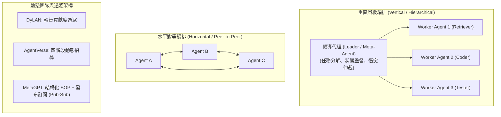

# Multi-Agent Orchestration (多智能體編排架構)

**多智能體編排（Multi-Agent Orchestration）** 是將多個具備專門能力的單體 AI Agent 整合為高凝聚力、自適應、分散式生態系統的核心架構技術。依據 [[2026 - Sapkota et al - AI Agents vs Agentic AI]] 與 [[2024 - Masterman et al - Landscape of Emerging AI Agent Architectures]]，多體編排實現了從「單體龐大 Prompt 模擬」向「模組化、角色約束（Role-bound）之系統級分散式認知」的根本性跨越。

---

## 1. 核心編排拓撲：垂直層級 vs 水平對等

### 1.1 垂直層級編排 (Vertical Architecture)
* **機制**：設立專職 **Leader / Meta-Agent**，承擔任務拆解、依賴管理與驗收。工作代理專注執行並單向或雙向回報。
* **領導力的實證影響 (Guo et al., 2024)**：
  * **無領導者團隊**：成員花費 **50% 的對話量** 在爭奪主導權或互相下達指令，效率極度低下。
  * **指定領導者團隊**：領導者承擔 60% 的指令輸出，其餘成員 100% 專注於任務資訊交換。
  * **人類在迴圈中（Human as Leader）**：**團隊完成任務速度提升近 10%**，展現最強的可靠性與對齊度。

### 1.2 水平對等協同 (Horizontal Architecture)
* **機制**：代理處於平等地位，共享討論執行緒（Group Chat）。適合腦力激盪、諮詢審查。
* **致命弊端與風險**：
  * **客套廢話（Superfluous Chatter）**：花費大量 Token 於社交客套（"How are you"）。
  * **諂媚效應（Sycophancy）**：極易盲目認同同儕的錯誤反饋，導致集體偏離目標。

---

## 2. 減少通訊雜訊與提升協同效率的工程解方

為解決多 Agent 自然語言通訊的高昂損耗與語義漂移，主流框架發展出以下經典機制：

1. **結構化標準作業程序（SOP）與圖表 (MetaGPT)**：
   * 嚴禁 Agent 之間發送非結構化閒聊；
   * 強制各角色產出符合規範的工件（如 PRD 需求文檔、系統架構圖、API 代碼）。
   * **發布-訂閱（Publish-Subscribe）機制**：所有訊息匯入總線，Agent 僅訂閱自身角色相關的訊息，大幅降低 Context 膨脹。
2. **動態團隊重組與貢獻度篩選 (DyLAN)**：
   * 每一輪任務結束後評估各 Agent 的貢獻分數，僅淘汰低貢獻者、晉級前列 Agent 進入下一輪，兼顧多元性與計算成本。
3. **階段性生命週期管理 (AgentVerse)**：
   * 將協同流程切分為四個獨立階段：**專家招募（Recruitment） $\rightarrow$ 協同決策（Collaborative Decision） $\rightarrow$ 獨立執行（Action Execution） $\rightarrow$ 系統評估（Evaluation）**，可循環迭代直到目標達成。
4. **標準化開放協議 (Google Agent-to-Agent, A2A)**：
   * 打破框架孤島，制定具備安全預設（Security by Default）、非同步長週期支援與模態無關性的跨系統通訊協議。

---

## 3. 多體架構選型準則 (Trade-offs)

* **選型警示**：如 [[2024 - Masterman et al - Landscape of Emerging AI Agent Architectures]] 與 [[2024 - Kapoor et al - AI Agents That Matter]] 所述，**多 Agent 協同並不保證推理能力的線性提升**。
* 僅在需要**嚴格角色邊界（Role Isolation）**、**真實分散式平行執行**或**獨立批判視角（如 Red-Teaming）**時才應採用多體編排；其餘確定性任務應優先採用優化良好的單體代理。

---
## 引用來源
* [[2026 - Sapkota et al - AI Agents vs Agentic AI]]
* [[2024 - Masterman et al - Landscape of Emerging AI Agent Architectures]]
* [[2024 - Kapoor et al - AI Agents That Matter]]
* [[Single vs Multi-Agent Patterns]]
* [[Taxonomy of Intelligent Agents]]
* [[Challenges and Failure Modes of Agentic Systems]]
