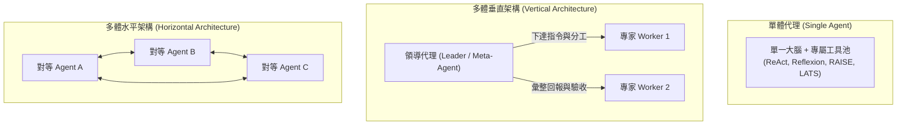

# Single vs. Multi-Agent Patterns (單體與多代理架構模式及拓撲分析)

在設計自主代理系統時，最核心的架構選型在於**單體代理（Single-Agent）**與**多代理（Multi-Agent）**的抉擇。依據 [[2024 - Masterman et al - Landscape of Emerging AI Agent Architectures]] 與 [[2026 - Sapkota et al - AI Agents vs Agentic AI]]，兩者分別適用於不同的問題複雜度與業務邊界。

---

## 1. 系統拓撲光譜 (Topological Spectrum)

### 1.1 單體架構模式 (Single-Agent Patterns)
* **特徵**：由單一 LLM 獨立掌控感知、推理、規劃與工具調用。
* **適用場景**：目標明確、工具集合有限且可由單一推理鏈完成的任務。
* **典型代表**：
  * **[[ReAct]]**：推理與行動交替迭代。
  * **RAISE**：在 ReAct 基礎上引入 Scratchpad 與長期相似案例檢索。
  * **[[Reflexion]]**：透過語言反饋模型進行後驗反思與自我糾錯。
  * **[[Agent Q]] / [[LATS]]**：引入樹搜尋（MCTS）與狀態回溯。

### 1.2 垂直層級架構 (Vertical Architecture)
* **特徵**：具備明確的組織層級。領導者（Leader / Meta-Agent）負責高階目標分解與任務派發，工作代理（Workers）專注於特定子任務並向領導者回報。
* **實證發現 (Guo et al., 2024)**：
  * **有領導者架構顯著優於無領導架構**：能減少 50% 的「互相發號施令」無效對話。
  * **人類作為 Leader 時效能最高**：完成任務速度提升近 10%。
  * 支援**動態團隊重組（Dynamic Reorganization）**：在規劃、執行、評估階段動態增刪 Agent。

### 1.3 水平對等架構 (Horizontal Architecture)
* **特徵**：代理之間地位平等，共享通訊執行緒（如同儕群聊），依靠自主協商、競標或輪流發言推進任務。
* **致命弊端**：
  * **客套廢話（Superfluous Chatter）**：易浪費大量上下文在社交問候上。
  * **諂媚效應（Sycophancy）**：容易盲目附和前一個 Agent 的錯誤判斷，導致錯誤滾雪球。
  * *解方*：必須引入 MetaGPT 式的「發布-訂閱（Pub-Sub）」或 DyLAN 式的「貢獻度過濾」機制。

---

## 2. 關鍵架構選型決策矩陣 (Decision Matrix)

| 決策維度 | 選擇單體代理 (Single Agent) | 選擇多代理架構 (Multi-Agent) |
| :--- | :--- | :--- |
| **任務定義明確度** | 高度明確、輸入輸出清晰 | 模糊、開放式、多階段相依 |
| **推理複雜度** | 單一 Prompt 經充分調優即可達成 | 需多種相互衝突的視角（如生成者 vs 審查者） |
| **平行執行需求** | 偽並行（單執行緒依賴式調用） | **真並行（多個獨立決策實體同時推進不同子模組）** |
| **權限與安全邊界** | 單一工具池，權限無法細分 | **嚴格角色約束（Role-bound）與最小特權隔離** |
| **通訊與 Token 成本**| 低，無額外協同通訊損耗 | 較高，需嚴防對話膨脹 |

> **理論警示 (Wang et al., 2024 & Kapoor et al., 2024)**：
> 「多 Agent 討論未必提升推理上限。」若單一 Agent 的 Prompt 與重試（Retry / Warming）機制已足夠穩健，盲目引入多 Agent 協商只會徒增延遲與經濟成本。

---
## 引用來源
* [[2024 - Masterman et al - Landscape of Emerging AI Agent Architectures]]
* [[2026 - Sapkota et al - AI Agents vs Agentic AI]]
* [[2024 - Kapoor et al - AI Agents That Matter]]
* [[Multi-Agent Orchestration]]
