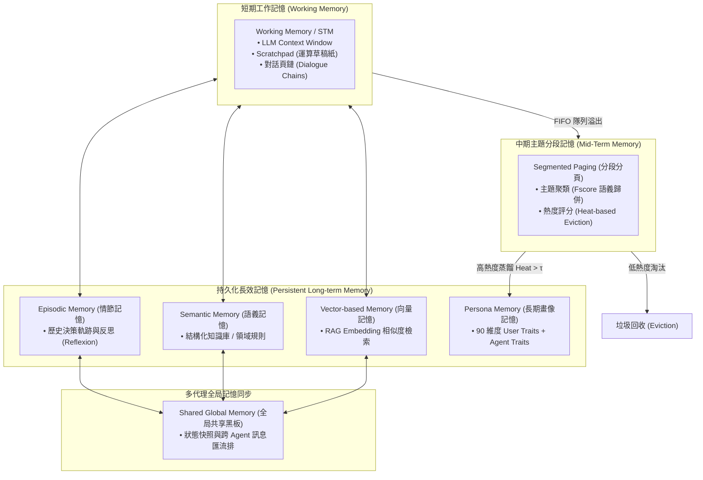

# Agent Memory Systems (代理記憶系統架構)

記憶系統是將大型語言模型（LLM）從「無狀態（Stateless）文本處理器」轉化為「具備時間連續性與經驗累積能力之智慧代理」的關鍵支柱。依據 [[2026 - Sapkota et al - AI Agents vs Agentic AI]]、[[2025 - Kang et al - Memory OS of AI Agent]] 與 [[2024 - Masterman et al - Landscape of Emerging AI Agent Architectures]] 的認知架構分析，現代代理記憶體系涵蓋多種時間維度、檢索機制與作業系統級的階層式管理。

---

## 1. 記憶分類與功能定義

### 1.1 工作記憶 (Working Memory / Short-Term Memory, STM)
* **形式**：當前 LLM Context Window、暫存草稿紙（Scratchpads）與即時通訊緩衝區。
* **特性**：容量有限（Token 預算限制）、易隨會話結束而丟失。
* **代表機制**：
  * **RAISE**（[[2024 - Masterman et al - Landscape of Emerging AI Agent Architectures]]）：利用 Scratchpad 記錄當前任務軌跡。
  * **[[MemoryOS]] STM**（[[2025 - Kang et al - Memory OS of AI Agent]]）：以包含 $\{Q, R, T, meta\}$ 的「對話頁（Dialogue Page）」構建連續對話鏈。

### 1.2 中期分段記憶 (Mid-Term Memory, MTM)
* **突破**：傳統架構直接從 Context 跳躍到向量庫，缺乏話題聚合概念。
* **[[MemoryOS]] 分段分頁機制**：依據主題將對話頁聚類為段（Segment），透過語義相似度 $F_{score} = \cos(e_s, e_p) + \mathcal{F}_{Jaccard}(K_s, K_p)$ 進行歸併，並以訪問頻率、互動長度與時間衰減計算 $Heat$ 分數進行動態置換。

### 1.3 情節記憶 (Episodic Memory)
* **定義**：記錄 Agent 過去「在何時、處於何種環境狀態、採取了何種動作、獲得了何種反饋」的具體經驗軌跡。
* **作用**：支援自我糾錯與反思機制（如 [[Reflexion]] 模式），防止重複陷入同一推理陷阱。

### 1.4 語義記憶 (Semantic Memory)
* **定義**：獨立於具體時間情節的事實性、概念性與規則性知識。以知識圖譜、關聯式資料庫或嚴格 JSON Schema 存儲領域準則，防止幻覺。

### 1.5 長期個人化畫像記憶 (Long-term Personal Memory, LPM)
* **突破**：[[2025 - Kang et al - Memory OS of AI Agent]] 提出將 User Persona 細化為 90 維度的 User Traits（涵蓋基本人格、AI 對齊維度、興趣偏好）及動態知識庫（User KB），使 Agent 在經歷數週後仍能主動喚醒長期目標。

---

## 2. 主流 Agent 記憶架構橫向對比

| 記憶架構 | 記憶儲存結構 | 淘汰/管理機制 | 長對話穩定性 (如 [[LoCoMo]]) | Token 消耗與開銷 |
| :--- | :--- | :--- | :--- | :--- |
| **MemGPT** | 雙層（主上下文 + 外部儲存） | 扁平 FIFO 翻頁 | 容易產生主題混雜 | 極高（平均 16,977 Tokens） |
| **A-Mem** | 互聯筆記圖譜 (Note Graph) | 動態邊鏈接 | 語義豐富但鏈接易累積誤差 | 較高（平均 13.0 次調用） |
| **MemoryBank**| 向量資料庫 | 單純艾賓浩斯遺忘曲線 | 無法保留跨主題階層依賴 | 效果最差（F1 分數低） |
| **RAISE** | Scratchpad + 歷史案例庫 | 相似案例檢索 | 適合垂直客服，缺乏自適應更新 | 中等 |
| **[[MemoryOS]]** | **三層階層式 (STM/MTM/LPM)** | **分段分頁 + 熱度置換** | **最優（F1 平均提升 49%，時間推理 +118%）** | **極低（3,874 Tokens / 4.9 次調用）** |

---

## 3. 單體 Agent 與 Agentic AI 在記憶機制上的關鍵分野

| 維度 | AI Agents (單體) | Agentic AI (多代理生態) |
| :--- | :--- | :--- |
| **記憶存取模式** | 單一通道、本地讀寫 | **分散式私有記憶 + 全局共享黑板 (Global Blackboard)** |
| **持久性** | 任務內連續；任務重置後通常丟失 | **跨工作流程階段、多會話持久保存** |
| **記憶一致性風險** | 僅需管理自身的 Context 膨脹 | **語義漂移（Contextual Drift）、資料競爭（Race Condition）** |
| **記憶回填與反思** | 自我啟發式提示詞更新 | **跨代理審計（Verifier Agent 審查並沉澱至公共知識庫）** |

---
## 引用來源
* [[2026 - Sapkota et al - AI Agents vs Agentic AI]]
* [[2025 - Kang et al - Memory OS of AI Agent]]
* [[2024 - Masterman et al - Landscape of Emerging AI Agent Architectures]]
* [[MemoryOS]]
* [[Taxonomy of Intelligent Agents]]
* [[Multi-Agent Orchestration]]
* [[LoCoMo]]
