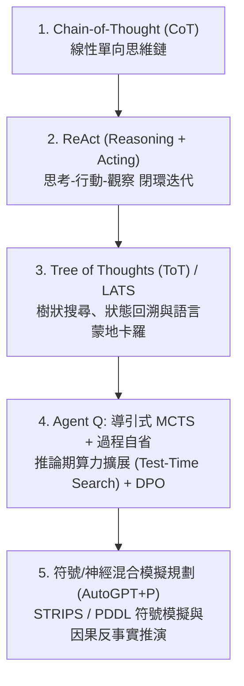
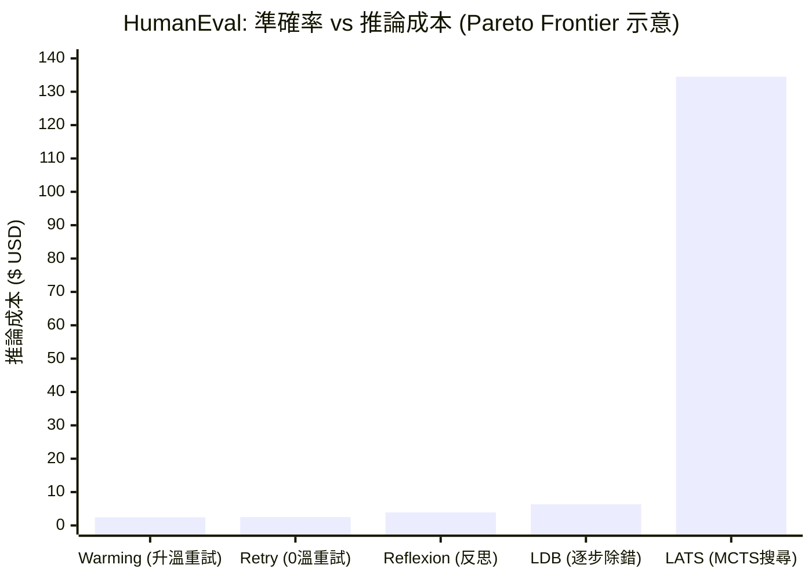

# Agent Planning & Reasoning (代理規劃與推理機制)

> 🖥️ **教學資源**：已為本概念製作沉浸式互動 HTML 簡報，適合初學者快速建立心智模型：[Agent Planning & Reasoning 互動簡報 (HTML)](file:///c:/Users/User/OneDrive/文件/LLM_wiki/presentations/agent_planning_and_reasoning.html)。

規劃（Planning）與推理（Reasoning）是智慧代理的心智核心，決定了 Agent 如何解析高階目標、制定操作路徑、並在動態環境中應對異常與調整策略。依據近期前沿研究，規劃機制正經歷從「純啟發式思維鏈」向「推論期樹搜尋（MCTS）」與「符號/因果模擬規劃」的深層演變，同時面臨著「複雜推理是否真勝過簡單重試」的深刻學術反思。

---

## 1. 核心規劃範式演進光譜

### 1.1 線性啟發式：Chain-of-Thought (CoT)
* 透過逐步提示引導推理，但缺乏外部反饋驗證，容易引發幻覺滾雪球。

### 1.2 閉環互動式：ReAct 與 Reflexion
* **[[ReAct]]**：交替執行思考與工具調用（`Thought -> Action -> Observation`），大幅降低靜態幻覺。局限在於模型容易反覆產生相同思考，陷入循環。
* **[[Reflexion]]**（Shinn et al. / [[2024 - Masterman et al - Landscape of Emerging AI Agent Architectures]]）：引入語言強化學習，在任務失敗後生成「語意自省日誌（Verbal Reflection）」，指導下一輪嘗試。

### 1.3 樹狀搜尋與推論期算力擴展：LATS 與 Agent Q
* **[[LATS]] (Language Agent Tree Search)**：將狀態表示為樹節點，借鑑 AlphaGo 的 MCTS 演算法，以語言模型自省評估作為探索啟發式。
* **[[Agent Q]]**（[[2024 - Putta et al - Agent Q]]）：
  * 在 POMDP 網頁環境下，將 MCTS 與 **LLM Critic 步驟級過程評估（Process Supervision）** 結合。
  * 實證表明：在真實 OpenTable 長程任務中，推論期搜尋將成功率從 18.6% 暴推至 **95.4%**，具體驗證了 Richard Sutton 的「苦澀的教訓（The Bitter Lesson）」——**推論期搜尋（Search）結合自適應學習（Learning）具備極高的算力擴展上限**。

### 1.4 符號與神經混合規劃：AutoGPT+P
* [[2024 - Masterman et al - Landscape of Emerging AI Agent Architectures]] 總結了 **AutoGPT+P**：由於純 LLM 缺乏嚴格的邏輯保證，該方法將 LLM 提煉的高階目標交由經典符號規劃器（基於 PDDL 規劃語言）求解，解決了實體機器人任務中的物理動作前置條件約束。

---

## 2. 當前學術爭鳴：複雜「System 2」規劃真比極簡基線強嗎？

普林斯頓大學團隊在 [[2024 - Kapoor et al - AI Agents That Matter]] 中提出了震驚學界的實證反思：

1. **增益來源的質疑**：
   * 在 HumanEval 上，被冠以「System 2 思考」的複雜架構（LDB、LATS、Reflexion）在準確率上**並未顯著超越極簡的 Warming 重試策略（逐步將溫度由 0 提升至 0.5）**。
   * **成本懸殊**：LATS 花費 **$134.50**，而 Warming 僅花費 **$2.45**（相差 55 倍）。
2. **理論意涵**：
   * 當前社群宣稱的「自我反思/規劃帶來巨大突破」，許多時候僅是「多次隨機採樣（Sampling / Retries）」的數學必然，而非模型真正具備了高階因果推演。
   * 架構設計必須引入 [[Cost-Controlled Agent Benchmarking]]，在 **帕雷托前沿（Pareto Frontier）** 上衡量準確率與成本的平衡。

---

## 3. 未解瓶頸：因果理解缺失 (Lack of Causal Understanding)

如 [[2026 - Sapkota et al - AI Agents vs Agentic AI]] 所強調，不論是 ReAct 還是 MCTS，核心 LLM 仍基於文字統計關聯：
* **無法進行反事實推理**：難以回答「若第 3 步採取了不同干預，世界狀態將如何反饋？」
* **分佈外（OOD）脆弱性**：一旦真實環境發生規則或版面漂移（如訂票網站改版），統計規劃器極易在錯誤路徑上過度自信。

---
## 引用來源
* [[2026 - Sapkota et al - AI Agents vs Agentic AI]]
* [[2024 - Masterman et al - Landscape of Emerging AI Agent Architectures]]
* [[2024 - Kapoor et al - AI Agents That Matter]]
* [[2024 - Putta et al - Agent Q]]
* [[Cost-Controlled Agent Benchmarking]]
* [[Challenges and Failure Modes of Agentic Systems]]
