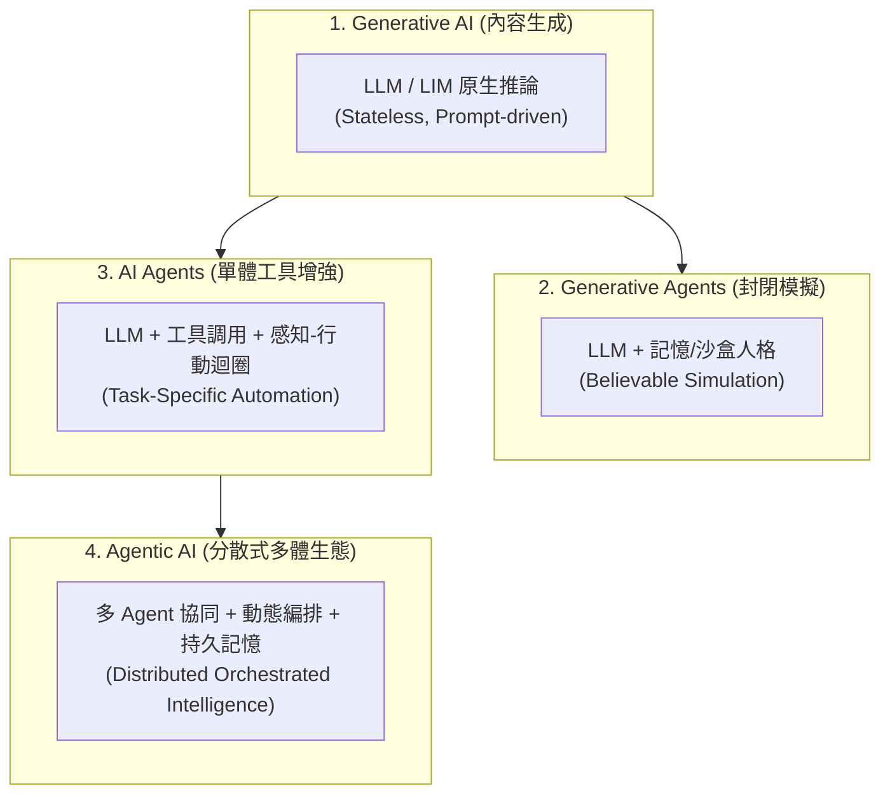

# Taxonomy of Intelligent Agents (智慧代理分類學)

在大型語言模型（LLM）驅動的現代自主系統中，清晰界定不同系統形態的能力邊界是架構設計的先決條件。依據 [[2026 - Sapkota et al - AI Agents vs Agentic AI]] 的學術界定，後 LLM 時代的智慧系統可嚴謹劃分為以下四種連續演進的認知範式：

---

## 1. 四大範式核心特性對比

| 概念維度 | Generative AI | Generative Agents | AI Agents (單體) | Agentic AI (多體生態) |
| :--- | :--- | :--- | :--- | :--- |
| **核心驅動力** | 對 Prompt 的被動文字/多模態預測 | 角色扮演提示與局部沙盒事件 | 針對特定任務的工具調用閉環 | **多 Agent 通訊、協商與目標分解** |
| **交互模式** | `User -> LLM -> Output` | `Agent -> Environment -> Output` | `User -> Agent -> Tool -> Output` | `User -> Orchestrator -> Multi-Agents` |
| **自主性等級** | 低（無外部行動能力） | 中（封閉環境擬人化） | 中等（在邊界約束內具自主執行權） | **高（跨全流程自主管理與調度）** |
| **時間與狀態** | 完全無狀態（Stateless） | 限於單一場景上下文 | 短期任務內連續，結束後重置 | **跨生命週期持久存在（Persistent Memory）** |
| **目標靈活性** | 無目標概念 | 固定子任務目標 | 執行具體、定義明確之任務 | **動態重構目標、適應環境變動** |
| **代表實例** | GPT-4, Midjourney, Claude | 史丹佛虛擬小鎮 (Park et al., 2023) | ChatGPT Web Search, AutoGPT, Claude Computer Use | MetaGPT, ChatDev, CrewAI, Google A2A |

---

## 2. 範式躍遷關鍵機制

### 2.1 從 Generative AI 到 AI Agents：工具增強閉環
* **突破**：克服 LLM 靜態訓練資料與「無肢體、無環境互動」的限制。
* **機制**：引入 [[Tool Augmentation & Function Calling]] 與 [[Agent Planning & Reasoning]]（如 ReAct 模式），形成「感知 $\rightarrow$ 思考 $\rightarrow$ 行動 $\rightarrow$ 觀察」的閉環。

### 2.2 從 AI Agents 到 Agentic AI：分散式認知與編排
* **突破**：單一 Agent 無法承載超長程規劃與多重專業角色，且易在單點推理錯誤時崩潰。
* **機制**：
  1. **任務分解（Task Decomposition）**：將抽象複雜問題切分為有相依性的 DAG（有向無環圖）。
  2. **角色特化（Role Specialization）**：不同 Agent 各司其職，限定職權與通訊協議。
  3. **[[Multi-Agent Orchestration]]**：由 Meta-Agent 監督全域狀態並進行錯誤恢復。
  4. **[[Agent Memory Systems]]**：跨 Agent 的全局語義與情節記憶同步。

---

## 3. 架構選型權衡 (Trade-offs & System Design)

在實際工程設計中，必須避免兩大典型架構失誤：
1. **Under-engineering (低估複雜度)**：試圖用單一 Prompt 或單一 ReAct Agent 處理需多角度審查、具強狀態相依的跨領域長流程（如軟體全生命週期開發），將導致上下文溢出與嚴重幻覺。
2. **Over-engineering (過度工程化)**：對於檢索摘要、日程確認、特定表格提取等確定性子任務，過度引入多 Agent 協商只會增加 API 延遲、顯著提升 Token 成本，並引發潛在的通訊競爭條件。

---
## 引用來源
* [[2026 - Sapkota et al - AI Agents vs Agentic AI]]
