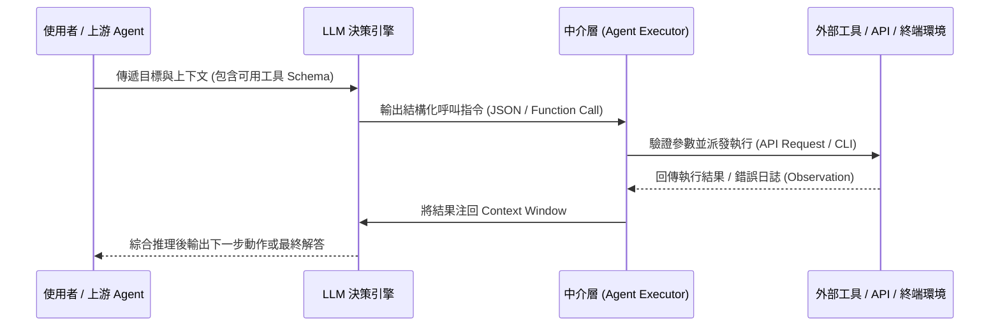

# Tool Augmentation & Function Calling (工具增強與函式調用機制)

單純的語言模型僅能處理內部的符號預測，無法對現實物理或數位環境產生作用。**工具增強（Tool Augmentation）** 與 **函式調用（Function Calling）** 是賦予 LLM 「行動能力（Agency）」的關鍵橋樑，使其從靜態文字生成器躍升為能夠即時獲取資料、執行運算、操縱軟體介面的自主實體。

依據 [[2026 - Sapkota et al - AI Agents vs Agentic AI]]，工具調用架構已從早期的單純 API 請求封裝，演進為跨多 Agent 的管線編排核心。

---

## 1. 核心運作生命週期 (The Tool Invocation Cycle)

現代工具增強系統遵循標準的四步閉環：

1. **工具識別與調用決策 (Tool Invocation)**：
   * LLM 在推理過程中識別自身內建知識無法滿足的缺口（如即時數據、精密數學計算、資料庫查詢）。
   * 根據 System Prompt 中預先定義的工具規格（JSON Schema / OpenAPI Spec），產出符合語法的調用參數。
2. **中介層派發與環境執行 (Execution Layer)**：
   * 執行中介軟體（如 LangChain Agent Executor、OS 指令環境）攔截結構化輸出，執行底層調用（如 SQL 查詢、Python 程式碼執行、REST API 請求）。
3. **結果解析與上下文回注 (Result Integration)**：
   * 將外部工具返回的原始資料進行清理、截斷或摘要，並包裝為 Observation 標籤插入 LLM 的上下文視窗中。
4. **反思與狀態轉移 (Iterative Deliberation)**：
   * 代理根據工具反饋評估是否已達成子目標，決定繼續調用其他工具或生成最終結論。

---

## 2. 單體代理 vs. 多代理生態在工具使用上的維度差異

| 特性維度 | 單體 AI Agent 工具使用 | Agentic AI (多代理生態) 工具使用 |
| :--- | :--- | :--- |
| **工具庫規模與分工** | 單一 Agent 承載龐大 Tool 列表，易引發注意力分散與調用混淆 | **角色特化（Role-based Separation）**：每個 Agent 僅配備與其專門職能匹配的最小工具集 |
| **輸出與輸入相依性** | 工具輸出僅供自身進行下一步推理 | **管線編排（Pipeline Orchestration）**：Agent A 的工具調用結果直接作為 Agent B 的輸入邊界 |
| **邊界與驗證機制** | 通常依賴 LLM 自行解析錯誤訊息 | **嚴格架構校驗**：引入 Schema 驗證協議（如 Waitgpt 等校驗層）與沙箱隔離 |
| **典型場景** | ChatGPT 聯網搜尋、Claude Computer Use 填表與終端操作 | 軟體工程多 Agent 系統（如 Code Generator $\rightarrow$ Test Runner $\rightarrow$ Linter） |

---

## 3. 面臨之工程與安全挑戰

1. **參數幻覺與 Schema 漂移 (Schema Mismatch)**：
   * 即使有明確的型別定義，LLM 在複雜巢狀參數中仍可能捏造欄位名稱或傳入不合規的資料型態。
2. **工具錯誤傳播與死循環**：
   * 若外部 API 回傳 404、500 或不符合預期的格式，單體 Agent 常反覆嘗試相同無效調用，耗盡 Token 預算。
3. **安全風險與越權操作 (Tool Abuse & Injection)**：
   * 間接提示注入攻擊（Indirect Prompt Injection）：第三方 API 回傳的非可信文本可能夾帶惡意指令，欺騙 Agent 執行高危險操作（如刪除資料庫、洩漏金鑰）。
   * *防禦策略*：嚴格的角色隔離機制（Role Isolation）、只讀/可寫權限分離（RBAC）、操作白名單與人機協同確認（Human-in-the-loop）。

---
## 引用來源
* [[2026 - Sapkota et al - AI Agents vs Agentic AI]]
* [[Taxonomy of Intelligent Agents]]
* [[Multi-Agent Orchestration]]
