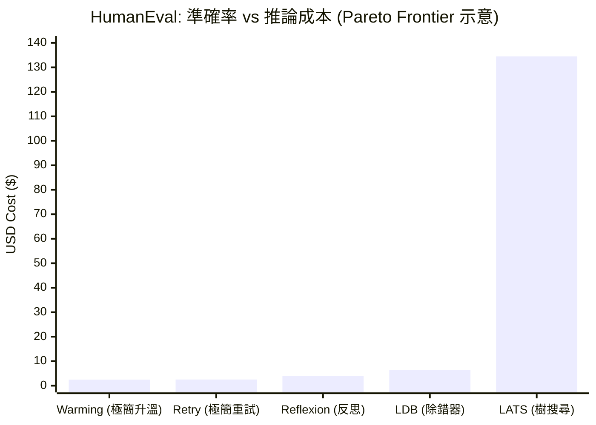

# Cost-Controlled Agent Benchmarking (成本受控之代理評測方法論)

在傳統機器學習中，模型評測通常以靜態資料集上的準確率（Accuracy, F1 等）為唯一準繩。然而，在以大型語言模型（LLM）為核心的 Agent 時代，普林斯頓大學團隊（[[2024 - Kapoor et al - AI Agents That Matter]]）提出重大警示：**缺乏成本控制的 Agent 評測本質上是無效的，且正在誤導學術界與產業界**。

---

## 1. 傳統評測的致命盲區：準確率與成本的脫節

LLM 具有內在隨機性（Stochasticity）。即使在溫度設為 0 的情況下，僅僅**多次重試（Retry）**或**逐步提升溫度採樣（Warming）**，就能顯著拉高代碼生成與數學基準的正確率：
* **「System 2」神話的戳破**：被廣泛引用的複雜反思與搜尋架構（如 [[LATS]]、[[Reflexion]]、LDB），在 HumanEval 上並未超越簡單的 Warming 重試策略（準確率約 93%），但 LATS 的推論花費高達 **$134.50**，而 Warming 僅需 **$2.45**（相差 55 倍）。
* **結論**：單純報告準確率，只會促使研究人員設計出極度昂貴、不可實用的「過載代理（Over-engineered Agents）」來霸榜。

---

## 2. 核心方法論：帕雷托前沿 (Pareto Frontier) 最佳化

評測 AI Agent 必須同時量測 **效能（Accuracy）** 與 **真實推理成本（Inference Cost in USD）**：
* **固定成本（Fixed Costs）**：單次超參數（提示詞、範例選擇）的搜尋花費。
* **變動成本（Variable Costs）**：每次任務推理產生的 Token 計費。在真實世界規模化部署中，變動成本佔 99% 以上。
* **聯合最佳化實踐**：藉由修改 DSPy 與 Optuna 進行雙目標搜尋，可將變動成本降低 40%~53% 而完全不損失準確率。

---

## 3. 泛化等級與保留集規範 (Generality Levels & Holdout Sets)

為防範 Agent 開發者有意或無意地利用特定規則「刷分（Shortcut Exploitation）」（如 STeP 在 WebArena 上硬編碼 URL 捷徑），基準測試必須具備與宣稱泛化程度匹配的**未見保留集（Holdout Sets）**：

| 泛化等級 | 評測目標 | 必須具備的保留條件 (Holdouts) | 現存基準合格率 |
| :--- | :--- | :--- | :--- |
| **1. Distribution-specific** | 特定任務分佈（如小學算術） | 同分佈樣本（In-distribution） | 100% (1/1) |
| **2. Task-specific** | 特定業務任務（如機票預訂） | **分佈外漂移（Out-of-distribution Drift）** | 50% (3/6) |
| **3. Domain-general** | 單一領域任意任務（如網頁操作） | **完全未見過的新任務 (Unseen Tasks)** | **僅 12.5% (1/8)** |
| **4. Fully-general** | 通用 AGI 跨領域代理 | **完全未見過的新領域 (Unseen Domains)** | **0% (0/2)** |

---

## 4. 模型評測 vs 下游工程評測之差異

* **學術模型評測（Model Evaluation）**：應控制計算量（Compute / FLOPs），尋求架構創新的純粹增益。
* **下游工程採購評測（Downstream Evaluation）**：**必須看具體美元成本（Dollar Cost）與端到端延遲**。廠商標榜的「活躍參數量」不等於真實收費，評測應如實記錄輸入/輸出 Token 數以供即時重算。

---
## 引用來源
* [[2024 - Kapoor et al - AI Agents That Matter]]
* [[2026 - Sapkota et al - AI Agents vs Agentic AI]]
* [[2024 - Masterman et al - Landscape of Emerging AI Agent Architectures]]
* [[Challenges and Failure Modes of Agentic Systems]]
