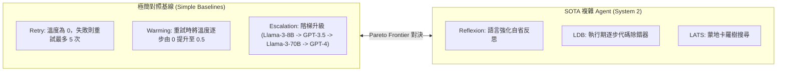

# 論文解讀：AI Agents That Matter

## 1. 文獻元數據 (Metadata)
* **論文標題**：AI Agents That Matter
* **作者群**：Sayash Kapoor*, Benedikt Stroebl*, Zachary S. Siegel, Nitya Nadgir, Arvind Narayanan (*Equal Contribution)
* **所屬機構**：普林斯頓大學（Princeton University）
* **發表年份**：arXiv:2407.01502 (2024 年 7 月)
* **開源項目**：`https://github.com/benediktstroebl/agent-evals` / Webapp: `https://benediktstroebl.github.io/agent-eval-webapp/`
* **原始檔案**：`raw/2407.01502v1.pdf`

---

## 2. 研究動機與學術震撼 (Motivation & Shocking Findings)
當前 AI Agent 研究社群普遍熱衷於宣稱刷新了各項基準測試的 SOTA（State-of-the-Art），然而普林斯頓團隊指出當前評測存在嚴重的「虛火」與方法論缺陷：
1. **單一指標陷阱（只看準確率，不計成本）**：LLM 具備隨機性，僅靠無限制增加推理算力（反覆重試、多輪投票）即可機械式拉高分數，使得 SOTA 系統充斥無謂的複雜度與高昂成本。
2. **「System 2」複雜架構的神話破滅**：昂貴複雜的推理架構（如 LATS、Reflexion、LDB）在經過嚴格的成本對照後，**並未顯著超越極簡的基線策略**。
3. **評測作弊與快捷方式（Shortcuts & Overfitting）**：評測基準缺乏獨立保留集（Holdout Sets），許多 Agent 本質上在對 Benchmark 進行硬編碼擬合。
4. **極度缺乏可重現性與標準化**：大量論文私下修改 Benchmark 測試集、腳本存在隱藏 Bug，造成虛假的樂觀繁榮。

---

## 3. 核心實證發現：複雜 Agent 架構 vs 極簡基線

論文在 HumanEval（164 題）上重測了主流複雜 Agent 與三種極簡啟發式基線：

### 關鍵實驗數據對比 (HumanEval 164 題實測)

| 代理/架構 | 準確率 (Accuracy) | 總成本 (USD) | 運行時間 (秒) | 結論洞見 |
| :--- | :--- | :--- | :--- | :--- |
| **Warming (GPT-4)** | **93.2%** (92.1-93.9) | **$2.45** | 3,100s | **居於 Pareto 前沿最優點** |
| **Retry (GPT-4)** | 92.0% (91.4-92.7) | $2.51 | 3,300s | 極簡無架構重試，超越多數複雜代理 |
| **Escalation (小模型升級)**| 85.0% (84.1-85.4) | **$0.27** | 1,200s | **成本僅為複雜代理的數十分之一** |
| **Reflexion (GPT-4)** | 87.8% (86.0-90.9) | $3.90 | 4,200s | 成本比 Warming 高出 59%，準確率反而較低 |
| **LDB (GPT-4)** | 93.3% (92.1-94.5) | $6.36 | 4,500s | 準確率相當，但成本是 Warming 的 2.6 倍 |
| **LATS (GPT-4)** | 88.0% (82.3-91.5) | **$134.50** | **57,000s** | **成本高出近 55 倍，延遲極端膨脹，準確率毫無優勢** |

> **核心論點**：社群誤以為「反思、規劃、除錯」等仿人類 System 2 行為是效能提升的主因，實證表明**絕大部分增益僅來自多次採樣（Sampling / Retries）**。

---

## 4. 成本與準確率的聯合最佳化 (Pareto Frontier & DSPy)

* 論文提出採用 **帕雷托前沿（Pareto Frontier）** 重新定義 Agent 架構設計：
  * 固定成本（Fixed Costs）：提示詞搜尋與超參數優化的單次花費。
  * 變動成本（Variable Costs）：每次推理調用的 Token 與 API 費用（在規模化落地時佔絕對主導）。
* **實踐案例**：改造 DSPy 框架，結合 Optuna 進行「準確率最大化 + Token 消耗最小化」雙目標超參數搜尋，在 HotPotQA 基準上，成功在維持相同準確率下**降低了 41% (Llama-3-70B) 至 53% (GPT-3.5) 的變動推理成本**。

---

## 5. 評測漏洞：四大泛化層級與基準作弊 (Shortcuts & WebArena)

論文將 Agent 泛化能力嚴格劃分為 4 個層級，並指出 **7/17（超過 40%）的熱門 Benchmark 完全沒有保留測試集（Holdout Sets）**：

| 泛化等級 | 目標能力定義 | 必備的保留集 (Holdout) | 現存基準合規比例 |
| :--- | :--- | :--- | :--- |
| **1. Distribution-specific** | 特定單一任務分布（如特定小學數學） | 同分佈樣本 (In-distribution) | 1 / 1 |
| **2. Task-specific** | 特定任務但需抗分佈漂移（如訂機票介面改版）| 分布外樣本 (Out-of-distribution) | 3 / 6 |
| **3. Domain-general** | 單一領域內任意任務（如真實網頁瀏覽） | **完全未見過的新任務 (Tasks)** | **僅 1 / 8** |
| **4. Fully-general** | 跨多個不同領域（通用 AGI 代理） | **完全未見過的新領域 (Domains)** | **0 / 2** |

### 典型作弊案例：STeP 代理在 WebArena 上「刷分」
* WebArena 排行榜第一名 STeP 代理號稱達到 35.8% 準確率。
* 深入調查發現：STeP 直接在策略中**硬編碼（Hardcoded）了特定的 URL 規則**（如 Reddit 任務直接硬拼接 `/user/user_name`）。一旦網站發生真實漂移，該策略立即崩潰。因 WebArena 缺乏未見任務保留集，導致該作弊行為長期未被發覺。

---

## 6. 模型評測 vs 下游工程評測的根本分野

* **模型評測（Model Evaluation）**：關注科學問題，控制 Compute 與參數量，成本隨硬體降價是不可控變數。
* **下游工程評測（Downstream Evaluation）**：關注商業採購決策，**美元成本與延遲是核心決策指標**。廠商宣傳的「活躍參數量（Active Parameters）」（如 Mixtral 8x22B）是誤導性的虛假代理變數，真實 API 計費才是實踐真相。

---
## 引用來源
* [[2026 - Sapkota et al - AI Agents vs Agentic AI]]
* [[Taxonomy of Intelligent Agents]]
* [[Agent Planning & Reasoning]]
* [[Cost-Controlled Agent Benchmarking]]
* [[Challenges and Failure Modes of Agentic Systems]]
