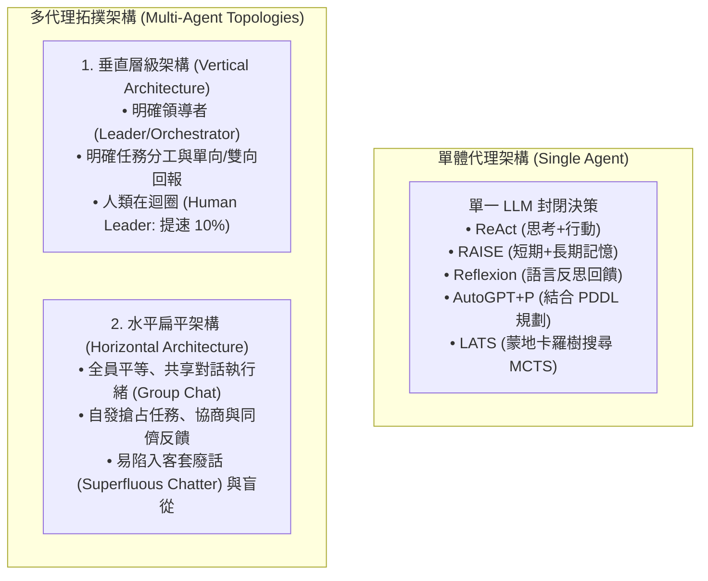

# 論文解讀：The Landscape of Emerging AI Agent Architectures for Reasoning, Planning, and Tool Calling: A Survey

## 1. 文獻元數據 (Metadata)
* **論文標題**：The Landscape of Emerging AI Agent Architectures for Reasoning, Planning, and Tool Calling: A Survey
* **作者群**：Tula Masterman, Sandi Besen, Mason Sawtell, Alex Chao
* **通訊機構**：Neudesic (An IBM Company)、IBM、Microsoft
* **發表年份**：arXiv:2404.11584 (2024 年 4 月)
* **原始檔案**：`raw/2404.11584v1.pdf`

---

## 2. 研究動機與核心命題 (Motivation & Core Questions)
隨著 LLM 從單純的 RAG 聊天機器人轉型為具備目標導向能力的 Agent，學術與工程社群面臨核心架構爭論：**「何時該選擇單體 Agent？何時該構建多 Agent 系統？」**
本篇綜述對當前主流的單體與多體架構展開系統性梳理，歸納規劃、執行、反思階段的關鍵設計模式與選型權衡。

---

## 3. 核心理論與架構分類學 (Architectural Taxonomy)

論文提出智慧代理遵循「大腦（Brain）、感知（Perception）、行動（Action）」的三元核心定義，並將系統拓撲劃分為單體與兩大多體架構：

---

## 4. 單體架構代表模式深度剖析

| 架構模式 | 核心機制 | 優勢與突破 | 固有局限性 |
| :--- | :--- | :--- | :--- |
| **[[ReAct]]** | Thought $\rightarrow$ Action $\rightarrow$ Observation 閉環迭代 | HotpotQA 幻覺率由 14% (CoT) 降至 6% | 容易反覆生成相同思維，陷入無法跳出的執行死循環 |
| **RAISE** | ReAct + 雙層記憶（Scratchpad 短期記憶 + 向量相似案例長期記憶） | 增強長對話上下文保留，微調小模型即可超車 ReAct | 缺乏嚴格角色邊界時容易角色幻覺（如客服代理自發寫 Python 代碼） |
| **[[Reflexion]]** | 語言強化學習（Verbal Reinforcement Learning） | 透過語言反饋 evaluator 自我糾錯，顯著提升成功率 | 容易收斂至非全局最優局部解（Local Minima），依賴滑動視窗而非資料庫 |
| **AutoGPT+P** | LLM 規劃結合經典符號規劃語言（PDDL） | 解決純神經網路缺乏因果推理問題，有效指引實體機器人任務 | 工具選擇準確率不穩定，探索失誤率高，缺乏人機互動校準 |
| **[[LATS]]** | 語言代理樹搜尋（結合 MCTS + 語言模型自省啟發式） | 將狀態空間樹狀化，支援回溯與多路徑模擬，推理能力極強 | 運算開銷巨大、延遲極高，主要測試於玩具問題 |

---

## 5. 多體架構代表模式與關鍵發現

### 5.1 領導力與動態架構的影響 (Guo et al., 2024)
* **無領導者團隊**：Agent 花費 **50% 的通訊量** 互相發號施令，溝通成本高且效率低下。
* **指定領導者團隊**：領導者承擔 60% 的指令下達，其餘成員專注於情報交換；**若由人類擔任 Leader，團隊完成任務速度提升近 10%**。
* **動態輪換領導（Dynamic Team Structure）**：依任務階段（規劃、執行、評估）動態重組團隊，產出最佳成果且通訊成本最低。

### 5.2 主流多體框架機制
* **DyLAN**：動態評估每輪 Agent 的貢獻度評分，僅保留高貢獻節點進入下一輪迭代。
* **AgentVerse**：嚴格劃分四階段——**招募（Recruitment）、協同決策（Decision）、獨立執行（Action）、評估（Evaluation）**。
* **MetaGPT**：為消除無效自然語言對話，要求 Agent 輸出**結構化標準作業程序（SOP）文檔與圖表**，並採用「發布-訂閱（Pub-Sub）」機制過濾非相關訊息。

---

## 6. 單體 vs 多體選型核心權衡 (Key Trade-offs)

1. **「多體討論未必提升推理」的理論反思**：
   * 引用 Wang et al. (2024) 發現：**當單體 Agent 的 Prompt 足夠穩健時，引入多 Agent 討論並不會顯著提高推理上限**。架構師應根據業務邊界（是否需不同角色權限、是否需非同步平行處理），而非盲目為了提升「智商」而引入多 Agent。
2. **多體水平架構的致命缺陷——客套與諂媚（Sycophancy）**：
   * 在水平群聊中，Agent 容易花費 Token 互說客套話（"How are you", "Nice work"），且存在嚴重的諂媚行為（盲目認同同儕的錯誤反饋），導致偏離目標。
3. **真並行 vs 假並行**：
   * 單體 Agent 的非同步調用本質上仍由單一大腦串行決策；多體架構則支援真正的分散式非同步並行決策。

---

## 7. 評測基準的四大危機 (Evaluation Shortcomings)
1. **數據污染（Data Contamination）**：靜態 Benchmark 題庫被納入 LLM 預訓練集。
2. **缺乏多步工具調用評測**：傳統 MMLU/GSM8K 無法反映真實 Agent 能力，需轉向 [[SWE-bench]] 與 WildBench。
3. **過度擬合與缺少未見任務（Holdout Tasks）**：缺乏真實世界的漂移（Drift）測試。

---
## 引用來源
* [[2026 - Sapkota et al - AI Agents vs Agentic AI]]
* [[Taxonomy of Intelligent Agents]]
* [[Multi-Agent Orchestration]]
* [[Challenges and Failure Modes of Agentic Systems]]
