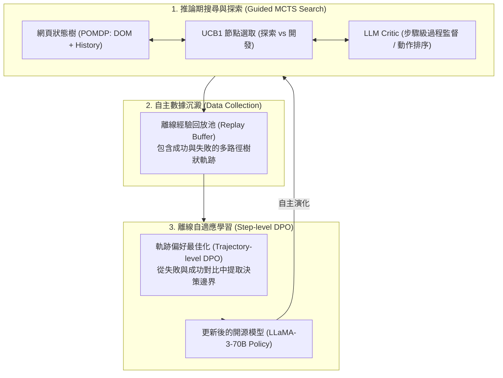

# 論文解讀：Agent Q: Advanced Reasoning and Learning for Autonomous AI Agents

## 1. 文獻元數據 (Metadata)
* **論文標題**：Agent Q: Advanced Reasoning and Learning for Autonomous AI Agents
* **作者群**：Pranav Putta1, Edmund Mills1, Naman Garg1, Sumeet Motwani1, Chelsea Finn2, Divyansh Garg1, Rafael Rafailov2
* **所屬機構**：The AGI Company (MultiOn)1, Stanford University2
* **發表年份**：arXiv:2408.07199 (2024 年 8 月)
* **原始檔案**：`raw/2408.07199v1.pdf`

---

## 2. 研究動機與解決痛點 (Motivation & Problem Statement)
目前 LLM 在多步驟、互動式動態環境（如複雜網頁導航、線上預訂）中的自主決策能力極其脆弱：
1. **靜態 SFT 的誤差累積與探索受限**：依賴專家演示的監督微調（SFT / 行為複製 Behavior Cloning）極易發生複合誤差（Compounding Errors），且無法探索非最優軌跡。
2. **長程任務的獎勵稀疏與責任分配困境 (Credit Assignment)**：
   * 真實網頁交互步數多（如 OpenTable 預訂平均 13.9 步），只有最後成功/失敗的 0/1 稀疏獎勵。中途任何微小偏差（如日期選錯）都會導致失敗，傳統 RL 無法有效向中間步驟歸因。
3. **線上探索（Online RL）的安全性風險**：若直接在真實網站上以 PPO 進行無監督線上探索，將引發高危險操作（如誤扣款、錯誤發布）。

---

## 3. 核心理論與認知架構：Agent Q (Core Architecture)

Agent Q 結合了 **推論期導引搜尋 (MCTS)**、**AI 自我反思批判 (Process Supervision)** 以及 **離線軌跡偏好強化學習 (Trajectory-DPO)**：

### 3.1 數學符號定義 (POMDP Formulation)
* **環境建模**：$(\mathcal{O}, \mathcal{S}, \mathcal{A}, T, R, \mu_0, \gamma)$，處於部分可觀察馬可夫決策過程（POMDP）。
* **緊湊狀態表示**：HTML DOM 往往長達數十萬 Token，故 Agent Q 壓縮歷史軌跡 $h_t = (a_1, \dots, a_{t-1}, o_t)$，並結合內部獨白（Inner Monologue）的 Plan、Thought、Action、Explanation 四元組。
* **複合價值函數估計**：
  $$Q(h_t, a_t^i) = \alpha \tilde{Q}(h_t, a_t^i) + (1-\alpha) \hat{Q}(h_t, a_t^i)$$
  * $\tilde{Q}$：MCTS 反向傳播計算的經驗回報。
  * $\hat{Q}$：由 LLM Critic 依據步驟潛在價值所生成的過程監督排序評分。

### 3.2 軌跡級直接偏好最佳化 (Trajectory-DPO)
利用樹狀搜尋天然產生的分叉建立偏好對 $(a^w_t, a^l_t)$，無需單獨維護複雜的 Critic 網路或在線 Value Function：
$$\mathcal{L}_{T-DPO}(\pi_\theta; \mathcal{D}) = -\mathbb{E}_{(\tau_w, \tau_l) \sim \mathcal{D}} \left[ \log \sigma \left( \sum_{t=0}^{|\tau_w|} \beta \log \frac{\pi_\theta(a_t^w|h_t^w)}{\pi_{ref}(a_t^w|h_t^w)} - \sum_{t=0}^{|\tau_l|} \beta \log \frac{\pi_\theta(a_t^l|h_t^l)}{\pi_{ref}(a_t^l|h_t^l)} \right) \right]$$

---

## 4. 核心實驗結論與突破性數據

### 4.1 模擬環境：WebShop (1,087 個保留未見任務)
* 基底模型：Salesforce xLAM-v0.1-r (Mixtral-8x7B)。
* **零樣本 SFT**：28.6%
* **軌跡級 DPO**：40.6%
* **Agent Q + MCTS 推論搜尋**：**50.5%**（正式**超越人類平均水平 50.0%**）。

### 4.2 真實即時環境：OpenTable 餐廳預訂 (平均 13.9 步長長程任務)
* 基底模型：LLaMA-3-70B-Instruct。
* **LLaMA-3-70B Zero-Shot**：18.6%
* **GPT-4o Zero-Shot**：62.6%
* **單輪 RFT (600 條軌跡)**：67.2%
* **Agent Q (經過 1 天自主數據收集與 DPO)**：**81.7%** (零樣本成功率相較基線**相對提升 340%**，超越 GPT-4o)
* **Agent Q + MCTS 推論期搜尋**：**95.4%**（近乎完美的真實世界自主預訂能力）。

---

## 5. 理論洞見與未來方向 (Insights & Future Work)
1. **推論期搜尋（Test-Time Search）是革命性支柱**：驗證了 Sutton 的「苦澀的教訓（The Bitter Lesson）」——結合「通用搜尋（MCTS）與學習（RL）」的架構，隨推論算力增長而持續擴展。
2. **從失敗中學習（Negative Trajectories Matter）**：傳統 RFT 僅過濾成功範例；而 DPO 能充分利用失敗軌跡中的關鍵錯誤節點，學習精確的懲罰邊界。
3. **在線安全性局限**：在銀行轉帳、合約簽署等不可逆操作中，MCTS 探索存在誤操作風險，未來需整合嚴格的安全審查員（Safety Critics）與人機協同切入點。

---
## 引用來源
* [[2026 - Sapkota et al - AI Agents vs Agentic AI]]
* [[Taxonomy of Intelligent Agents]]
* [[Agent Planning & Reasoning]]
* [[Agent Q]]
* [[Challenges and Failure Modes of Agentic Systems]]
