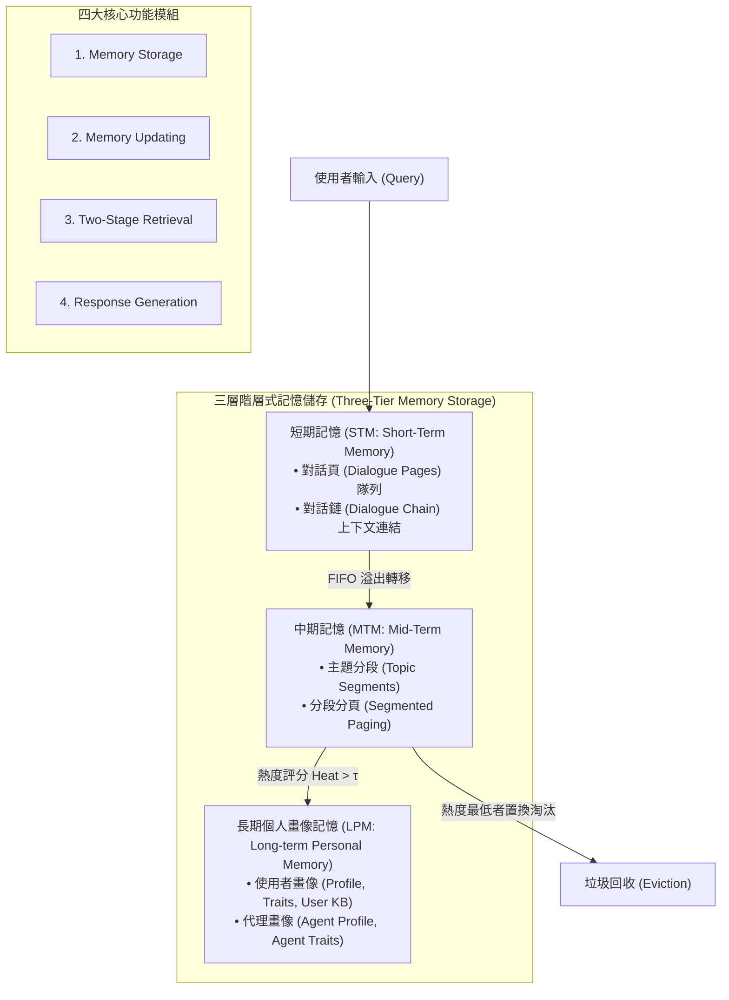

# 論文解讀：Memory OS of AI Agent

## 1. 文獻元數據 (Metadata)
* **論文標題**：Memory OS of AI Agent
* **作者群**：Jiazheng Kang, Mingming Ji, Zhe Zhao, Ting Bai
* **所屬機構**：北京郵電大學（Beijing University of Posts and Telecommunications）、騰訊 AI Lab（Tencent AI Lab）
* **發表會議**：EMNLP 2025 (Pages 25961–25970)
* **開源代碼**：`https://github.com/BAI-LAB/MemoryOS`
* **原始檔案**：`raw/2025.emnlp-main.1318.pdf`

---

## 2. 研究動機與痛點 (Motivation & Problem Statement)
LLM 代理在長週期對話與終身個人化互動中面臨嚴重的記憶管理瓶頸：
1. **固定上下文視窗限制**：LLM 依賴固定長度 Context Window，無法維持跨多會話（Multi-session）的時間連續性，導致事實不一致與個人化流失。
2. **現存記憶機制孤立且缺乏系統性**：
   * *知識組織型（如 A-Mem, TiM）*：建立圖譜或思維節點，但多步鏈接耗時且容易累積誤差。
   * *檢索型（如 MemoryBank, EmotionalRAG）*：僅靠單一向量檢索或遺忘曲線，無法維護跨主題的上下文階層關聯。
   * *架構型（如 MemGPT, SCM）*：雖借鑑作業系統（OS）概念，但 MemGPT 採用扁平 FIFO 隊列，長對話中極易產生主題污染（Topic Mixing）。
3. **缺乏統一的記憶作業系統**：未曾有工作將 OS 的「分段分頁（Segmented Paging）」與「熱度置換（Heat-based Eviction）」原理系統性導入 Agent 記憶管理。

---

## 3. 核心理論與認知架構設計 (Core Architecture)

MemoryOS 借鑑現代作業系統的虛擬記憶體管理思想，建構了包含四大功能模組（儲存、更新、檢索、生成）的**三層階層式記憶體系**：

### 3.1 三層記憶儲存模組 (Storage Module)
1. **短期記憶 (STM)**：以「對話頁（Dialogue Page, $page_i = \{Q_i, R_i, T_i, meta^{chain}_i\}$）」為單位，維護固定長度隊列（預設容量為 7），利用 LLM 評估語義連貫性並動態串聯為對話鏈。
2. **中期記憶 (MTM)**：採用**分段分頁架構**。以「主題」為段（Segment），每個段內包含多個對話頁。依據語義向量與關鍵詞相似度，動態歸併新頁面至相應主題段中。
3. **長期個人記憶 (LPM)**：
   * **User Persona**：靜態屬性（年齡、性別）+ 動態使用者知識庫（User KB，容量 100）+ **90 維度個性化特徵標籤（User Traits）**（涵蓋基本需求與人格、AI 對齊維度、興趣標籤）。
   * **Agent Persona**：靜態角色設定（Agent Profile）+ 動態交互習慣（Agent Traits）。

---

## 4. 關鍵數學公式與狀態機制 (Mathematical Formulation)

### 4.1 MTM 語義分段相似度公式
對話頁 $page_i$ 與既有主題段 $segment_i$ 的歸併判定：
$$F_{score} = \cos(e_s, e_p) + \mathcal{F}_{Jaccard}(K_s, K_p)$$
* $e_s, e_p$：主題段與對話頁的 Embedding 向量餘弦相似度。
* $K_s, K_p$：LLM 提煉的主題關鍵字集合，$Jaccard = \frac{|K_s \cap K_p|}{|K_s \cup K_p|}$。
* 當 $F_{score} > \theta$（預設 0.6）時歸併入該段，確保主題內語義一致。

### 4.2 MTM 熱度置換評分 (Heat Score Eviction)
當 MTM 超過最大容量（2000 段）時，淘汰熱度最低的段；當熱度超過閾值 $\tau$（預設 5）時升級至 LPM：
$$Heat = \alpha \cdot N_{visit} + \beta \cdot L_{interaction} + \gamma \cdot R_{recency}$$
$$R_{recency} = \exp\left(-\frac{\Delta t}{\mu}\right)$$
* $N_{visit}$：被檢索訪問次數。
* $L_{interaction}$：段內包含的對話頁數量（互動深度）。
* $R_{recency}$：時間衰減係數，$\Delta t$ 為上次訪問至今之秒數，$\mu = 10^7$。

---

## 5. 實驗設定與核心基準結論 (Experiments & Benchmarks)

* **評測數據集**：
  * **GVD**：虛擬使用者 10 天跨期對話。
  * **LoCoMo**：長週期超長對話基準（平均 300 輪，每段對話約 9,000 Tokens），劃分 Single-hop, Multi-hop, Temporal, Open-domain 四類問題。
* **對比基準**：MemGPT、A-Mem、TiM、MemoryBank。
* **核心實驗數據**：
  * 在 **LoCoMo** 基準上（以 GPT-4o-mini 為基底），MemoryOS 的 **F1 分數平均提升 49.11%**，**BLEU-1 提升 46.18%**。
  * 在 **Temporal（時間推理）** 類別上，F1 提升高達 **118.80%**。
  * **效率優勢顯著**：MemoryOS 每次回答平均僅消耗 **3,874 Tokens** 與 **4.9 次 LLM 調用**，遠低於 MemGPT（16,977 Tokens）與 A-Mem（13.0 次調用）。

---

## 6. 局限性與未來方向 (Limitations)
1. **容量超參數依賴經驗值**：STM 隊列長度（7）與 MTM 容量缺乏認知科學模型支撐。
2. **缺乏主題動態合併（Dynamic Merging）**：主題段的劃分依賴初次提取，若對話主題持續演化，可能產生語義重疊的冗餘段落。

---

## 7. 對本知識庫的貢獻與體系定位
本篇論文為本知識庫提供了具體可工程落地的 **作業系統級記憶架構（OS-inspired Agent Memory）**，填補了概念頁中關於「記憶分層實作、熱度過期策略與動態畫像演進」的理論細節。

---
## 關聯頁面 (Wikilinks)
* [[Agent Memory Systems]]
* [[MemoryOS]]
* [[Taxonomy of Intelligent Agents]]
* [[LoCoMo]]
