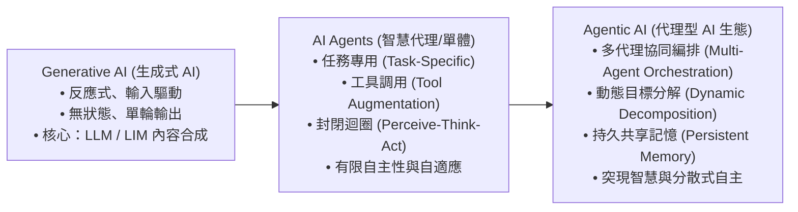

# 論文解讀：AI Agents vs. Agentic AI: A Conceptual taxonomy, applications and challenges

## 1. 文獻元數據 (Metadata)
* **論文標題**：AI Agents vs. Agentic AI: A Conceptual taxonomy, applications and challenges
* **作者群**：Ranjan Sapkota, Konstantinos I. Roumeliotis, Manoj Karkee
* **通訊機構**：美國康乃爾大學（Cornell University, Department of Biological and Environmental Engineering）、希臘伯羅奔尼撒大學（University of the Peloponnese）
* **發表期刊**：*Information Fusion* (Elsevier), Volume 126, 2026, 103599 (線上發表於 2025 年 8 月)
* **DOI / 原始連結**：`https://doi.org/10.1016/j.inffus.2025.103599`
* **原始檔案**：`raw/1-s2.0-S1566253525006712-main.pdf`

---

## 2. 研究動機與解決痛點 (Motivation & Problem Statement)
隨著 ChatGPT 於 2022 年底問世，產學界對「智慧代理」的關注度爆炸性增長，但文獻與產業實踐中長期將 **AI Agents** 與 **Agentic AI** 混為一談（Conflation）：
1. **概念模糊引發系統架構錯位**：
   * 開發者常「低估複雜度」（Under-engineering），試圖用單一 AI Agent 解決本質上需要分散式多智能體協同的複雜任務。
   * 或「過度工程化」（Over-engineering），在只需單一工具調用 Agent 的簡單場景下，硬套繁複的多 Agent 協同框架。
2. **單體 Agent 的理論與能力瓶頸**：
   * 單一 Agent 依賴無狀態（Stateless）的 LLM Prompt 與簡單啟發式迴圈，面臨缺乏因果推理（Causal Reasoning）、提示詞脆弱性（Prompt Brittleness）、長期規劃潰散（Long-Horizon Failure）等致命瓶頸。
3. **缺乏形式化分類學與統一藍圖**：
   * 缺乏跨越「生成式 AI (Generative AI) $\rightarrow$ 工具增強代理 (AI Agents) $\rightarrow$ 分散式多代理協同生態 (Agentic AI)」的完整演進認知與評測體系。

---

## 3. 核心理論與認知架構設計 (Core Conceptual Architecture)

本論文首次建立了嚴謹的階層式演進分類學，將智慧系統劃分為三大範式（外加 Generative Agents 模擬體）：

### 3.1 AI Agents 的四層基礎閉環
傳統/現代單體 AI Agent 運作於封閉迴圈（Input, Processing, Action, Learning）：
* **Perception Module (感知模組)**：接收結構化/非結構化訊號（Prompt、API 響應、多模態感測），進行模板化包裝與 RAG 檢索。
* **KRR (知識表示與推理模組)**：LLM 結合符號/統計邏輯，執行任務規劃與鏈式思考。
* **Action Module (動作模組)**：透過 JSON/API/Python 呼叫執行外部工具。
* **Learning & Adaptation (基礎學習)**：透過情境快取（Context Buffer）或啟發式反饋進行調整。

### 3.2 Agentic AI 的架構升級
Agentic AI 系統並非單一模型的延伸，而是系統級的分散式智慧，引入：
1. **Ensemble of Specialized Agents (角色特化代理群)**：如 [[Multi-Agent Orchestration]] 所述，每個 Agent 被嚴格賦予職責邊界（Role-bound，如 MetaGPT 中的 CEO、工程師、審查者）。
2. **Orchestration Layers / Meta-Agents (編排層/元代理)**：負責監督相依性、調度任務分配與衝突仲裁。
3. **Persistent & Shared Memory (持久化記憶)**：區分情節記憶（Episodic）、語義記憶（Semantic）與向量化共享記憶。
4. **Agent-to-Agent (A2A) Protocols**：如 Google 於 2025 年提出的 A2A 協議，支援跨框架、長週期、多模態的安全互通。

---

## 4. 分類與對比矩陣 (Taxonomy & Comparative Analysis)

根據論文 Table 1、Table 2 與 Table 3 的深入提煉：

| 維度 | Generative AI | AI Agents (單體) | Agentic AI (多體生態) |
| :--- | :--- | :--- | :--- |
| **主要定位** | 內容生成 (Content Generation) | 特定任務自動化執行 (Task Execution) | 複雜全流程目標編排 (Workflow Orchestration) |
| **觸發方式** | 使用者 Prompt 觸發（被動） | 具備工具調用的目標觸發 | 高階目標發起，子任務自主調度 |
| **目標靈活性** | 無彈性（固定於單次生成） | 執行定義明確的單一目標 | **動態分解、自適應調整目標** |
| **時間連續性** | 無狀態（Stateless） | 短期任務內連續 | **跨工作流程階段持久存在 (Persistent)** |
| **記憶利用** | 無記憶或僅限短 Context Window | 選配短期記憶快取 | **共享情節記憶與全域知識儲存庫** |
| **協同機制** | 無 | 孤立單體執行 (Isolated) | **階層式或去中心化多代理協同** |
| **運作瓶頸** | 缺乏環境交互與工具調用 | 缺乏因果理解、長程規劃易崩潰 | **誤差級聯、突現不穩定性、協同衝突** |

---

## 5. 核心挑戰與瓶頸 (Challenges & Bottlenecks)

論文深入梳理了兩大範式各自面臨的理論與工程困境：

### 5.1 AI Agents 的致命局限
1. **缺乏因果理解 (Lack of Causal Understanding)**：LLM 僅能學習統計關聯，無法區分相關與因果，無法進行反事實推理（Counterfactual Reasoning），面對分佈偏移（Distribution Shifts）時極易崩潰。
2. **繼承 LLM 內在缺陷**：幻覺（Hallucinations）、Prompt 脆弱性、上下文視窗邊界。
3. **長程規劃潰散 (Limited Long-Horizon Planning)**：即使採用 [[ReAct]] 或 [[Tree of Thoughts]]，本質仍是啟發式搜尋，缺乏內部時間與狀態演進模型，容易陷入無休止工具調用死循環。

### 5.2 Agentic AI 的系統級挑戰
1. **誤差級聯效應 (Error Cascades)**：前置 Agent（如事實檢驗）產生微小幻覺，會被後續 Agent 視為真理遞歸放大，造成整個系統決策崩塌。
2. **協同與溝通瓶頸 (Communication Bottlenecks)**：自然語言通訊存在語義漂移（Contextual Drift）；缺乏統一標準協議，容易出現競爭條件（Race Conditions）與死鎖（Deadlocks）。
3. **突現不穩定性 (Emergent Instability)**：多個自主任務代理互動時，產生非設計預期的突現行為（如無限規劃迴圈或互相矛盾的動作），黑盒推理鏈導致故障難以調試與追溯。
4. **形式化驗證缺失 (Verification Deficit)**：目前缺乏類似軟體工程的模型檢查（Model Checking）數學保證。

---

## 6. 十大演進架構與技術解決方案 (10 Solution Pathways)

論文提出了解決上述局限的 10 項前沿架構解方：
1. **[[Retrieval-Augmented Generation (RAG)]]**：作為多 Agent 的共享真實世界錨點。
2. **[[Tool Augmentation & Function Calling]]**：將 LLM 轉變為可調用 API 的決策者，建立清楚的動作邊界。
3. **Agentic Loops ([[ReAct]])**：推理-行動-觀察（Thought-Action-Observation）迭代，自我糾錯。
4. **[[Agent Memory Systems]]**：整合情節記憶（Episodic）、語義記憶（Semantic）與向量檢索記憶。
5. **[[Multi-Agent Orchestration]] (Role Specialization)**：引入 Meta-Agent（如虛擬 CEO）監督任務生命週期與相依性。
6. **[[Reflexive and Self-Critique Mechanisms]]**：引入跨 Agent 交叉審查機制（Verifier / Auditor），如 [[Reflexion]] 範式。
7. **程式化提示管線 (Programmatic Prompt Pipelines)**：自動化模板與角色約束，降低 Prompt 脆弱性。
8. **因果建模與模擬規劃 (Causal Modeling & Simulation Planning)**：結合 STRIPS / PDDL 規劃語言，在執行前透過模擬環境預測行為後果。
9. **監控、審計與可解釋性管線 (Auditing & Explainability Pipelines)**：記錄完整決策軌跡與 Agent 通訊日誌。
10. **治理感知架構 (Governance-Aware Architectures)**：角色權限隔離（RBAC）、沙盒限制與法律責任歸屬追踪。

---

## 7. 未來研究方向 (Future Roadmap)
* **無資料自我對弈強化推理 (AZR, Absolute Zero: Reinforced Self-play Reasoning)**：擺脫對外部標註資料的依賴，藉由可驗證反饋（如代碼執行）自主生成問題、驗證並共同演化。
* **統一編排與開放協議**：推動如 Google A2A 等標準跨平台通訊協議。
* **從被動向主動智慧 (Proactive Intelligence)**：從等待 Prompt 指令，轉化為依據情境與潛在目標自發行動。

---

## 8. 對本知識庫的貢獻與體系定位
本篇論文作為本知識庫的 **奠基綜述（Foundational Survey）**，為所有後續收錄的架構論文（如 ReAct, Reflexion, MetaGPT 等）提供了最高層級的分類座標系與術語標準。

---
## 關聯頁面 (Wikilinks)
* [[Taxonomy of Intelligent Agents]]
* [[Agent Memory Systems]]
* [[Agent Planning & Reasoning]]
* [[Tool Augmentation & Function Calling]]
* [[Multi-Agent Orchestration]]
* [[Challenges and Failure Modes of Agentic Systems]]
