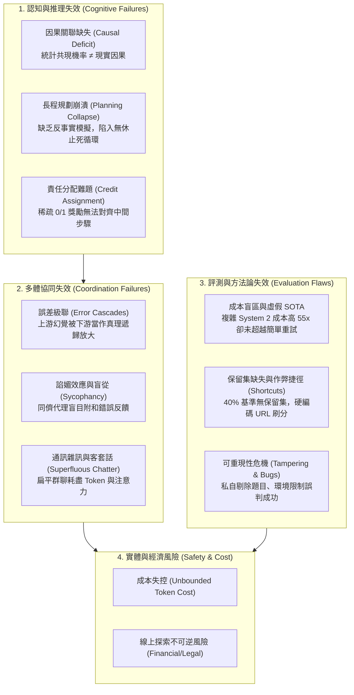

# Challenges and Failure Modes of Agentic Systems (智慧代理系統之失效模式與挑戰綜述)

隨著智慧代理從封閉的對話介面走向開放、真實世界的任務執行，系統的脆弱性與潛在失效模式亦呈現指數級放大。綜合 [[2026 - Sapkota et al - AI Agents vs Agentic AI]]、[[2024 - Kapoor et al - AI Agents That Matter]]、[[2024 - Masterman et al - Landscape of Emerging AI Agent Architectures]] 與 [[2024 - Putta et al - Agent Q]] 的深度批判，本專題縱觀了當前智慧代理在**認知因果、協同機制、評測基準與經濟成本**四大維度的系統級失效模式。

---

## 1. 核心失效維度全景圖

---

## 2. 深入剖析：四大核心失效場景

### 2.1 認知與規劃失效：統計關聯的極限
* **因果理解缺陷**（Sapkota et al., 2026）：LLM 僅掌握詞彙共現統計，缺乏結構因果模型（SCM）。在面對分佈漂移時，無法預測介入（Intervention）的真正後果。
* **長程任務的責任分配（Credit Assignment）困境**（Putta et al., 2024）：在平均超過 13 步的網頁預訂中，僅靠最終成敗回報無法訓練中間決策，必須依靠過程評估（Process Supervision）與樹搜尋。

### 2.2 多體協同失效：群聊幻覺與諂媚
* **諂媚效應（Sycophancy）與錯誤放大**（Masterman et al., 2024）：在水平無領導群聊中，Agent 容易盲目迎合其他 Agent 的陳述；前置 Agent 產生的微小偏誤在下流被擴大為致命錯誤（Error Cascades）。
* **無效社交通訊損耗**：水平架構中的 Agent 常陷入客套寒暄（"How are you"、"Nice job"），嚴重擠佔有效上下文。

### 2.3 評測方法論危機：普林斯頓團隊的震撼發現 (Kapoor et al., 2024)
* **無成本對照的虛假繁榮**：
  * 在 HumanEval 上，號稱引入深度思維的 LATS 花費 **$134.50**，而極簡的 Warming 策略僅花費 **$2.45**，兩者準確率均為 ~93%。**社群誤將多次重試帶來的機率提升歸功於複雜架構設計**。
* **基準作弊與過度擬合 (Overfitting & Shortcuts)**：
  * 超過 40% 的熱門基準完全沒有 Holdout 測試集。STeP 代理在 WebArena 上透過直接硬編碼 URL 規則刷上第一名，一旦遭遇真實網站漂移便全盤失效。
* **評測代碼竄改與不可重現性**：
  * 許多論文在評測時私自刪除無測試案例的題庫（如 HumanEval 刪除 3 題），或因評測環境被限流（如 Reddit Rate Limit）而直接標記為成功。

### 2.4 真實世界線上部署的安全代價
* **不可逆動作的風險**（Putta et al., 2024）：在真實網頁環境中進行線上強化學習探索（如 PPO）具有極高破壞性，可能觸發不可逆的真實扣款、誤發電子郵件或刪除帳號，必須轉向具備沙盒隔離的離線軌跡強化學習（Trajectory-DPO）。

---

## 3. 前沿系統級防禦機制

1. **成本受控評測（[[Cost-Controlled Agent Benchmarking]]）**：以帕雷托前沿（Pareto Frontier）衡量準確率與變動 Token 成本。
2. **結構化工件替代自然語言（[[Multi-Agent Orchestration]]）**：如 MetaGPT 採用 SOP 規範文檔與 Pub-Sub 過濾，徹底根除客套廢話。
3. **推論期導引搜尋與自省（[[Agent Q]]）**：以 MCTS 配合 LLM Critic 進行步驟級過濾，並以離線 DPO 學習失敗軌跡。
4. **階層式記憶與熱度置換（[[MemoryOS]]）**：透過分段分頁與熱度評分淘汰過時記憶，防止主題混雜污染推理。

---
## 引用來源
* [[2026 - Sapkota et al - AI Agents vs Agentic AI]]
* [[2024 - Kapoor et al - AI Agents That Matter]]
* [[2024 - Masterman et al - Landscape of Emerging AI Agent Architectures]]
* [[2024 - Putta et al - Agent Q]]
* [[Cost-Controlled Agent Benchmarking]]
* [[Multi-Agent Orchestration]]
* [[Agent Memory Systems]]
